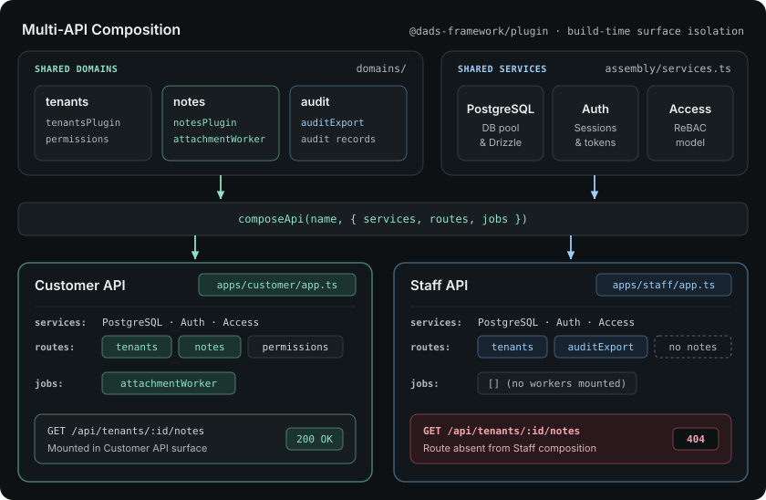

# Multi-API Composition & CI Gates

Dads is governed by the **[Independent Evolution Principle](../../principles.md#the-independent-evolution-principle)**: _things that can evolve independently are owned, represented, and contracted independently; things that change together live together_. Dads separates **which routes exist on an HTTP process** from **where domain code lives**, then checks import boundaries and code rules mechanically in CI.



## 1. Compose separate API entrypoints

Each file under `apps/<api>/app.ts` is a short manifest calling `composeApi` from [`@dads-framework/core/plugin`](../../../packages/core/README.md). It selects the domain plugins and background jobs that entrypoint exposes (`apps/customer/app.ts`):

<!-- dads:excerpt {"path":"apps/kit-workbench/apps/customer/app.ts","language":"ts","from":"export function customerApp(provider: ServiceProvider) {","through":"}"} -->

`apps/staff/app.ts` mounts internal routes (such as audit exports) and omits `notesPlugin` completely:

<!-- dads:excerpt {"path":"apps/kit-workbench/apps/staff/app.ts","language":"ts","from":"export function staffApp(provider: ServiceProvider) {","through":"}"} -->

Customer routes are not hidden behind a feature flag on the staff server; they are never registered on that Fastify instance.

## 2. Enforce domain boundaries with `dads.project.json`

`dads.project.json` declares your packages and the three boundary tiers:

```json
{
  "domainBoundaries": {
    "domains": ["src/domains/*", "domains/*"],
    "libraries": ["libraries/*"],
    "composition": ["src/composition", "apps/*", "assembly"]
  }
}
```

The import rules enforced by `npx dad check boundaries`:

- **`domains/*`** can import framework packages and `libraries/*`. A domain can never import another domain's tables, routes, or internals.
- **`libraries/*`** hold shared runtime tokens and base entity handles (such as `libraries/app-runtime/index.ts`) and import framework packages only.
- **`apps/*` and `assembly/`** sit in the composition tier and wire domains together with real infrastructure (PostgreSQL, auth, mail, object storage).

When one domain needs data from another domain, define a narrow TypeScript port and wire the implementation in `assembly/services.ts` instead of importing across domains.

```sh
npx dad check boundaries
```

## 3. Run Doctor and changed-file verification in CI

Every starter includes `npm run verify` and the `@dads-framework/toolbox` CLI for local and CI gates:

| Command                           | What it checks                                                                                                        |
| :-------------------------------- | :-------------------------------------------------------------------------------------------------------------------- |
| `npm run verify`                  | Runs boundary checks, TypeScript type-checking, web build, and tests                                                  |
| `npx dad check boundaries`        | Fails if any file crosses a domain boundary or undeclared dependency                                                  |
| `npx dad doctor --gate`           | Checks repo-wide rules: zero `any`, zero unsafe casts, routes with `access`, denial test coverage, and source budgets |
| `npx dad verify --changed --json` | Runs focused checks for files touched in the current branch                                                           |

> **Coding agents and CI:** Because boundaries, `access` declarations, and denial tests are verified by `dad check boundaries` and `dad doctor --gate`, broken imports or unguarded endpoints fail before code review.

## 4. Deploy outside development

Every generated starter ships with a `DEPLOY.md` and production scripts in `package.json`:

1. Install dependencies from the committed lockfile with `npm ci` and run `npm run verify`.
2. Set `DATABASE_URL`, `DADS_IDENTITY_SECRET`, and `DADS_BASE_URL` in your runtime secret store.
3. Run database migrations once before booting new API instances:

```sh
npm run migrate
```

4. Start each API process by selecting `DADS_API=customer` or `DADS_API=staff`:

```sh
NODE_ENV=production DADS_API=customer HOST=127.0.0.1 PORT=3000 npm run start:api
```

5. Check liveness against `/api/health`:

```sh
curl -fsS http://127.0.0.1:3000/api/health
```

A healthy process responds with HTTP `200` and `{ "data": { "status": "ok" } }`.

## Related references

- [`@dads-framework/toolbox`](../../../packages/foundation/toolbox/README.md) for all CLI commands and JSON output schemas
- [`@dads-framework/core/plugin`](../../../packages/core/README.md) for `composeApi`, `defineService`, and `providePlugin`
- [Architecture decisions](../../decisions/README.md)
