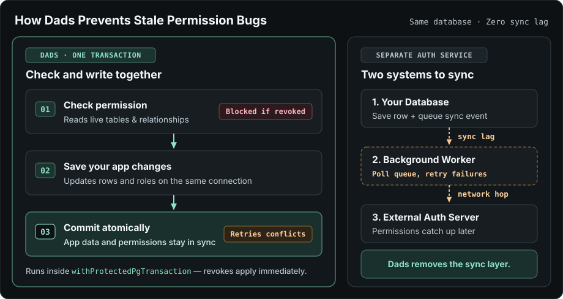

# Access & Permissions

**The last permissions system you'll ever need.**

Dads lets you write your permission rules once in plain TypeScript and runs them directly inside your existing PostgreSQL or SQLite database — **no extra auth server**, **no stale caches**, **no duplicating foreign keys**, and **mathematically verified** against 27 formal proofs.

- **Fast at any scale:** Sub-millisecond permission checks and instant paginated lists across millions of rows — using your existing tables and indexes.
- **No sync bugs:** Permission checks and database writes run inside the same transaction, so revoking access takes effect immediately.
- **Zero lock-in:** Start in SQLite or PostgreSQL today, import an existing SpiceDB setup, or migrate out to SpiceDB later without rewriting your app code.



## Why Dads beats the alternatives

| What you care about             | `if` checks     | Postgres RLS | SpiceDB / OpenFGA | **Dads**            |
| :------------------------------ | :-------------- | :----------- | :---------------- | :------------------ |
| **Revoke access immediately**   | Manual          | Yes          | Sync lag          | **Yes (same tx)**   |
| **Teams, folders & sharing**    | Gets messy fast | Hard SQL     | Yes               | **Yes**             |
| **No extra service to run**     | Yes             | Yes          | No                | **Yes**             |
| **Uses your existing tables**   | Yes             | Yes          | No (must copy)    | **Yes**             |
| **Fast paginated lists**        | Manual          | Fragile      | Extra network hop | **Yes (1 query)**   |
| **Fast unit tests (no Docker)** | Yes             | No           | No                | **Yes**             |
| **Mathematically verified**     | No              | No           | No                | **Yes (27 proofs)** |

---

## 5-Minute Quickstart

### 1. Define your model once in plain TypeScript

Declare actors (`actor`), resources (`resource`), roles (`roles`), and permissions (`can`). Child resources declare `inherit` explicitly (`"all"`, `"none"`, or a list like `["manage"]`) so sensitive resources like `billing` stay fail-closed (`packages/access/src/core/dsl.test.ts`):

<!-- dads:excerpt {"path":"packages/access/src/core/dsl.test.ts","language":"ts","from":"    const user = actor(\"user\");\n\n    const organization = resource(\"organization\", {\n      roles: {\n        admin: user,","through":"          can: ({ accountant }) => ({\n            view: accountant,\n          }),\n        },\n      },\n    });"} -->

Compile once at startup with `compileAccess([organization])`. Inspect the resolved tree anytime with `formatAccessTree(model)` or `npx dad access tree src/access.ts`.

### 2. Connect Postgres (plain `pg.Pool`, Drizzle, or SQLite)

Install `@dads-framework/access` and `@dads-framework/postgres-access` (zero ORM required):

```sh
npm install @dads-framework/access @dads-framework/postgres-access pg zod
```

Apply `relationshipSchemaMigration.sql`, bind any single-target foreign keys you already have on your tables (`documents.org_id`, `documents.owner_id`, `folders.parent_id`) with `columnRelations` so Postgres reads them directly with zero dual-writes, and verify columns/indexes at startup (`packages/server/postgres-access/src/column-relations.integration.test.ts`):

<!-- dads:excerpt {"path":"packages/server/postgres-access/src/column-relations.integration.test.ts","language":"ts","from":"function createColumnBindings(","through":"      targetIdColumn: \"owner_id\",\n    },\n  ];\n}"} -->

Pass `columnRelations: bindings` and `executor: preparePostgresChecks(pool)` into `new PostgresAuthorization(...)`, run `columnRelationIndexSql(bindings)` in your migration, and call `await authz.verifyColumnRelations()` at boot so missing columns fail fast.

> **Rule of thumb:** Put single-target foreign keys (`org_id`, `owner_id`, `parent_id`) in `columnRelations`. Keep dynamic grants (org memberships, groups, wildcards, expiring shares, bans, and multi-parent links) in the tuple table via `createAccessClient(authz).add(...)`.

Running local-first, edge, or single-node? Swap `PostgresAuthorization` for `SqliteAuthorization` from [`@dads-framework/sqlite-access`](../../../packages/server/sqlite-access/README.md) using Node's built-in `node:sqlite` (`DatabaseSync`) — exact same model, exact same `columnRelations` API.

### 3. Filter lists & guard writes in one transaction

Embed `resolveFilter({ ..., scopeColumns: "auto" })` directly inside paginated SQL `SELECT ... LIMIT 50` queries, and wrap protected writes in `withProtectedPgTransaction({ pool, authorization, retries: 2 }, work)` so revokes and business updates share one `SERIALIZABLE` snapshot with automatic `40001` retries (`packages/server/postgres-access/src/column-relations.integration.test.ts`):

<!-- dads:excerpt {"path":"packages/server/postgres-access/src/column-relations.integration.test.ts","language":"ts","from":"    const resolvedFilter = await authz.resolveFilter({","through":"    expect(resolvedRows.rows.map((row) => row.id)).toEqual([\"doc-org\"]);"} -->

<!-- dads:excerpt {"path":"packages/server/postgres-access/src/column-relations.integration.test.ts","language":"ts","from":"    // Update inside a protected serializable transaction; scoped authz preserves columnRelations.","through":"            resource: { type: \"document\", id: \"doc-null\" },\n          }),\n        ).toBe(true);\n      },\n    );"} -->

Using Drizzle? Import `withProtectedDrizzleTransaction` and `transactionExecutor` from `@dads-framework/postgres-access/drizzle` (`assembly/protected-write.ts`):

<!-- dads:excerpt {"path":"apps/kit-workbench/assembly/protected-write.ts","language":"ts","from":"export function createProtectedWrite(","through":"}"} -->

### 4. Test policies in microseconds (zero Docker, zero `await`)

Import `createAccessHarness` from `@dads-framework/access/testing` to test full inheritance, cycles, groups, bans, and expiring grants synchronously in plain unit tests (`packages/access/src/testing/access-harness.test.ts`):

<!-- dads:excerpt {"path":"packages/access/src/testing/access-harness.test.ts","language":"ts","from":"    const access = createAccessHarness(model);\n    const owner = access.actor(user, \"owner\");","through":"        [stranger, [\"deny\", \"deny\", \"deny\"]],\n      ],\n    });"} -->

When an assertion fails, the harness prints the exact **decision explanation tree** showing which ban, expired grant, or missing parent edge caused the mismatch.

---

## Attach permission guards to HTTP routes

Export named permission tokens (such as `organization.task.can.edit`) from `domains/<feature>/access/index.ts` and attach them to routes (`domains/notes/access/index.ts`):

<!-- dads:excerpt {"path":"apps/kit-workbench/domains/notes/access/index.ts","language":"ts","from":"import { fromParam, requires } from \"@dads-framework/http\";","through":"export const notesAccess = requires(notesPermission, fromParam(\"tenantId\"));"} -->

Every Dads HTTP route enforces access in strict order:

1. Missing or invalid session → **`401 Unauthorized`**.
2. Missing permission → **`404 Not Found`** before parsing the body or query (zero existence leaks).
3. Only authorized callers reach Zod validation and your handler.

---

## Ready for advanced patterns, benchmarks & SpiceDB cutover?

Read the **[Permissions Cookbook & Patterns](permissions-cookbook.md)** for source-backed recipes covering:

- **`columnRelations` deep dive & 10M-row benchmarks** (`2.73 GB → 30 MB`, `8,274 RPS`, `EXPLAIN ANALYZE` proof)
- **Nested folders (`recursive: true`), multi-parent DAGs, `group#member` usersets, wildcards (`user:*`), bans (`.unless()`), and `every()`**
- **Two-way SpiceDB migration** (`npx dads-import-spicedb --verify` coming in, `migratePostgresToSpiceDb` + `columnRelationOutboxTriggerSql` going out)
- **Connected `(from, to)` schema migrations** across Postgres, SQLite, and SpiceDB
- **SQLite & Postgres filter parity proofs** (`createSqliteTestAuthorization`, `proveSqliteFilterParity`, `provePostgresFilterParity`) and our **27 Lean 4 formal proofs**

## Related references

- [Permissions Cookbook & Patterns](permissions-cookbook.md)
- [SDK Glossary & Options](sdk-reference.md)
- [`@dads-framework/access`](../../../packages/access/README.md)
- [`@dads-framework/postgres-access`](../../../packages/server/postgres-access/README.md) & [10M-Row Benchmark Report](../../../packages/server/postgres-access/BENCHMARK.md)
- [`@dads-framework/sqlite-access`](../../../packages/server/sqlite-access/README.md)
- [`@dads-framework/authorization-migration`](../../../packages/server/authorization-migration/README.md)
- [Formal Verification (`formal/access-proofs`)](../../../formal/access-proofs/README.md)
