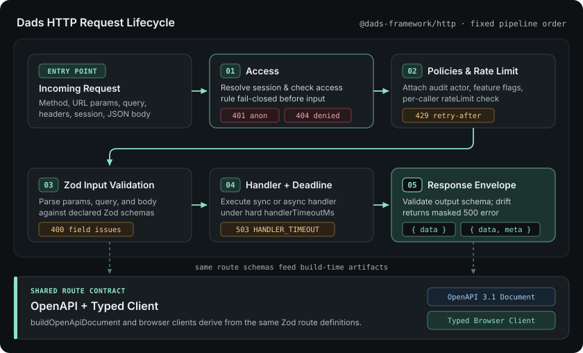

# Routes, Contracts & Clients

Every HTTP route in Dads is declared in one place: path, access rule, optional rate limit, Zod input schemas, and Zod response schema. That single definition validates requests, checks response shapes, generates OpenAPI 3.1, and keeps your clients in sync.

## 1. Define request and response shapes in `contract/wire.ts`

Keep API schemas separate from database tables and permission rules. Use `z.strictObject` on request inputs to reject unexpected fields, and `z.object` on responses so internal columns never leak (`domains/notes/contract/wire.ts`):

<!-- dads:excerpt {"path":"apps/kit-workbench/domains/notes/contract/wire.ts","language":"ts","from":"import { z } from \"zod\";","through":"  stateHash: z.string(),\n});"} -->

`domains/<feature>/contract/` contains zero server or database imports, so browser code, mobile SDK generators, and Node.js clients can import it safely.

## 2. Declare routes with typed verb helpers

Group your domain's routes with `routeGroup` and verb helpers (`getRoute`, `listRoute`, `postRoute`, `patchRoute`, `deleteRoute`) from `@dads-framework/http` (`domains/notes/server/routes.ts`):

<!-- dads:excerpt {"path":"apps/kit-workbench/domains/notes/server/routes.ts","language":"ts","from":"export function notesRoutes({","through":"}"} -->

### Route rules enforced by TypeScript

- **Required `access`:** Every route must pass a `PermissionAccess` (via `requires(...)`), `requiresVisible(...)`, `requiresScoped(...)`, `requireSession`, or `publicAccess`. Omitting `access` fails type-checking.
- **Named capabilities instead of anonymous middleware:** `rateLimit`, timeouts, and serving modes are declared fields on the route or group, never hidden middleware chains.
- **Response drift protection:** Handler return values are validated against `response` (or `item` on `listRoute`) before leaving the server.

## 3. Keep SQL and Drizzle inside a store module

Keep route handlers thin by placing Drizzle queries in a sibling `server/<feature>-store.ts` module (`domains/notes/server/notes-store.ts`). Route files wire HTTP contracts and access checks; store modules accept `db` or a write transaction `tx` and own SQL queries.

## 4. Call routes with a typed client

Bind route templates once with `defineRoute` from `@dads-framework/core/contract` and send validated requests with [`@dads-framework/client`](../../../packages/client/README.md) (`domains/notes/web-client/index.ts`):

<!-- dads:excerpt {"path":"apps/kit-workbench/domains/notes/web-client/index.ts","language":"ts","from":"const collectionPath = \"/tenants/:tenantId/notes\";","through":"export function createNote(tenantId: string, text: string) {\n  return sendToApi({\n    route: create.bind(tenantId),\n    body: { schema: noteInput, value: { text } },\n    returns: note,\n  });\n}"} -->

`getFromApi`, `getPageFromApi`, and `sendToApi` validate outgoing bodies and parse incoming responses against your Zod schemas, and work in React, Next.js, Vue, Svelte, or Node.js.

## 5. Generate OpenAPI 3.1

Pass your composed routes to `buildOpenApiDocument` from `@dads-framework/http` to generate an OpenAPI 3.1 document from the exact same Zod schemas and route metadata.

## Next steps

- [Multi-API Composition & CI Gates](boundaries-and-apis.md) to mount domain plugins on separate customer and staff APIs
- [`@dads-framework/http`](../../../packages/server/http/README.md) for raw routes, streaming responses, and error types
