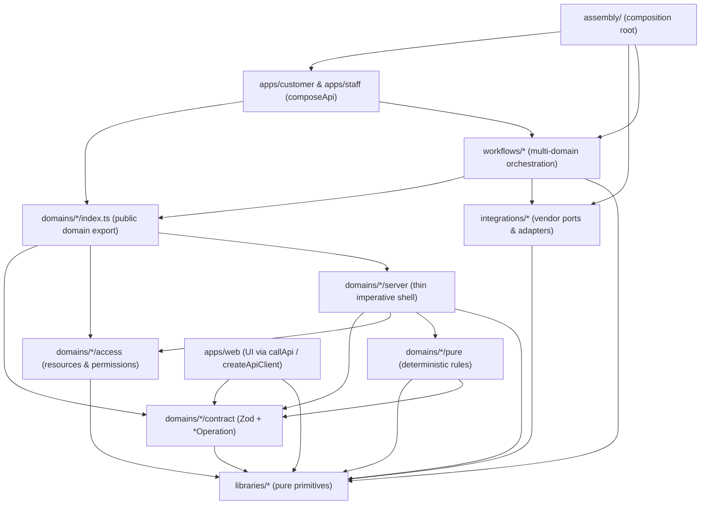

# Where Does Code Go?

When every kind of code has one obvious home, changes stop at the boundary that owns them and neither humans nor coding agents have to guess where a new file belongs.

This guide is the canonical placement map for a Dads application. `npx dad check boundaries` and `npx dad doctor --gate` verify these placements mechanically in CI.

## Where does this code go?

| Path                                              | What lives here                                                                                                                                                                                                                                                                                                                                                                                                             | Import & purity rules                                                                                                                                                 |
| :------------------------------------------------ | :-------------------------------------------------------------------------------------------------------------------------------------------------------------------------------------------------------------------------------------------------------------------------------------------------------------------------------------------------------------------------------------------------------------------------- | :-------------------------------------------------------------------------------------------------------------------------------------------------------------------- |
| `domains/<name>/contract/`                        | Branded IDs (`entityIdSchema`, `opaqueIdSchema`), Zod wire schemas (`z.strictObject` inputs, `z.object` responses), and standalone `*Operation` contracts (`getOperation`, `listOperation`, `postOperation`, `patchOperation`, `putOperation`, `deleteOperation`).                                                                                                                                                          | Imports `zod`, `@dads-framework/core/contract`, and `libraries/*`. Never imports `server/`, `pure/`, `access/`, or UI code.                                           |
| `domains/<name>/access.ts` (or `access/`)         | [`@dads-framework/access`](../../../packages/access/README.md) resource kinds (optionally bound to branded ID schemas via `id:`), relations, roles, grantable catalog metadata, and permission declarations for this domain.                                                                                                                                                                                                | Imports `@dads-framework/access`, its own domain's `contract/` ID schemas, and shared entity handles from `libraries/*`. Never imports `server/` or database tables.  |
| `domains/<name>/pure/`                            | Strictly pure, deterministic domain rules, state transitions, validation decisions, and calculations. Accepts timestamps, IDs, and inputs as explicit arguments.                                                                                                                                                                                                                                                            | Zero I/O, zero DB/HTTP imports, zero ambient `Date.now()`, `new Date()`, `Math.random()`, `randomUUID()`, or `process.env`. Enforced by `dad doctor` (`impure-code`). |
| `domains/<name>/server/`                          | Thin imperative shell: HTTP routes (`routes.ts`), Drizzle tables (`tables.ts` or generated via `dad db generate`), optional per-domain `migrations/`, queries (`store.ts`), domain jobs (`jobs.ts`), live ops actions, and plugin wiring (`plugin.ts`).                                                                                                                                                                     | Imports only its own domain's `contract/`, `access/`, `pure/`, `libraries/*`, and the narrow service tokens it declares. Never imports another domain.                |
| `workflows/<name>.ts`                             | Multi-domain orchestration and event subscribers coordinating two or more domains through their public exports or `@dads-framework/core/event-bus`.                                                                                                                                                                                                                                                                         | Imports domains via their public exports, `integrations/*` ports, and `libraries/*`. Never imports any domain's `server/` internals or tables.                        |
| `integrations/<vendor>/`                          | External API and SDK adapters (payment processors, messaging providers, ERPs, webhook verifiers) quarantined behind an app-owned capability port.                                                                                                                                                                                                                                                                           | Owns all third-party SDK imports and translates vendor payloads and errors into application-owned types at the edge.                                                  |
| `libraries/<name>/`                               | Pure, domain-free shared primitives (money math, formatting, shared value types, base entity IDs).                                                                                                                                                                                                                                                                                                                          | Imports framework packages and other `libraries/*` only. Never owns database tables, HTTP routes, or runtime singletons.                                              |
| `migrations/` (or `domains/*/server/migrations/`) | Chronological or DAG-ordered (`dependsOn`) immutable database migrations (`*.migration.ts`). Start with root `migrations/` for small apps; switch to per-domain `domains/<name>/server/migrations/` as domains grow (`applicationMigrationWorkspace`). SQL FKs are allowed by default; opt into `"strictForeignKeys": true` in `dads.project.json` paired with `@dads-framework/core/references` for shard-ready isolation. | Append-only once merged to the base branch; enforced by `dad doctor` (`migrations-edited`, `migrations-out-of-order`, and opt-in `cross-domain-foreign-keys`).        |
| `apps/<surface>/`                                 | Deployable entrypoints: `apps/customer/app.ts` and `apps/staff/app.ts` select domain plugins via `composeApi`; `apps/web/features/<domain>/`, `apps/web/components/`, and `apps/web/app/` consume domain `*Operation` contracts directly via `callApi` / `createApiClient`.                                                                                                                                                 | API entrypoints compose public domain plugins and workflows; `apps/web` imports only `domains/*/contract/` and `libraries/*`, never `server/`.                        |
| `assembly/`                                       | Thin composition root only: `config.ts`, `host.ts` (composable framework plugins + `startHttpHost`), `main.ts`, and `migrations.ts`. Binds concrete infrastructure to narrow service tokens.                                                                                                                                                                                                                                | The sole edge that selects concrete implementations and boots processes. Contains zero domain rules.                                                                  |

## The one-way dependency graph

Dependencies flow in one direction toward lower-volatility primitives. No domain imports another domain, UI never touches server code, and pure logic sits below every I/O seam:



### Why this keeps affected graphs small and makes DST effortless

- **Small affected graphs:** Editing a rule inside `domains/notes/pure/` dirties only that domain's pure tests and its own thin shell. Unrelated domains, `apps/web`, `integrations/*`, and other API surfaces stay clean in `npx dad verify --changed --json`.
- **Effortless Deterministic Simulation Testing (DST):** Because `domains/<name>/pure/` forbids ambient `Date.now()`, `new Date()`, `Math.random()`, `randomUUID()`, `process.env`, and I/O—verified mechanically by `dad doctor`'s `impure-code` signal—every domain decision is a pure function of its inputs. A DST harness can feed seeded clocks, IDs, and simulated interleavings through thousands of state transitions in milliseconds without booting Postgres or mocking a framework.

## Three anti-patterns this eliminates

1. **The fat `AllServices` god-bag → narrow `defineService` tokens.** Passing one global service bag into every feature couples every domain to every infrastructure client in the app. Instead, declare narrow capability tokens with `defineService` from [`@dads-framework/core/plugin`](../../../packages/core/README.md) and list only what a domain actually needs in `requires: [...]`. Tests wire only those tokens, and changing an unrelated integration never touches the domain.
2. **Mixing I/O into business rules → `pure/` + `impure-code`.** When SQL queries, clock reads, and branching business logic live inside the same route handler, you need a live database to test an edge case. Moving rules into `domains/<name>/pure/` separates decision-making from persistence, and `dad doctor` (`impure-code`) prevents ambient clock, randomness, environment, or I/O imports from creeping back in.
3. **Hand-wired `web-client/` boilerplate → `*Operation` + `callApi` / `createApiClient`.** Repeating URL templates and Zod schemas in hand-maintained `web-client/` wrappers invites silent drift between server and browser. Declare each endpoint once as a standalone `*Operation` contract in `domains/<name>/contract/`, pass it to `getRoute` / `postRoute` / `listRoute` on the server, and call it directly from `apps/web` with `callApi` or `createApiClient` from [`@dads-framework/client`](../../../packages/client/README.md).

## Pure core vs. thin imperative shell

Keep decisions in `domains/<name>/pure/` and keep `domains/<name>/server/` focused on parsing, access enforcement, reading inputs from narrow services, and writing the result.

`domains/notes/pure/note-rules.ts` — Pure, deterministic domain transition with explicit inputs and zero I/O

```ts
export type NoteRecord = {
  readonly id: string;
  readonly tenantId: string;
  readonly text: string;
  readonly archivedAt: Date | null;
};

export type ArchiveNoteResult =
  { readonly ok: true; readonly note: NoteRecord } | { readonly ok: false; readonly reason: "already_archived" };

export function archiveNote(note: NoteRecord, archivedAt: Date): ArchiveNoteResult {
  if (note.archivedAt !== null) {
    return { ok: false, reason: "already_archived" };
  }
  return {
    ok: true,
    note: { ...note, archivedAt },
  };
}
```

`domains/notes/pure/note-rules.test.ts` — Instant deterministic test with fixed inputs and zero containers

```ts
import { describe, expect, it } from "vitest";
import { archiveNote } from "./note-rules.js";

describe("archiveNote", () => {
  const fixedTime = new Date("2026-01-15T12:00:00.000Z");

  it("stamps archivedAt on an active note", () => {
    const result = archiveNote({ id: "note-1", tenantId: "tenant-1", text: "Ship guide", archivedAt: null }, fixedTime);
    expect(result).toEqual({
      ok: true,
      note: { id: "note-1", tenantId: "tenant-1", text: "Ship guide", archivedAt: fixedTime },
    });
  });

  it("refuses to archive a note twice", () => {
    const result = archiveNote(
      { id: "note-1", tenantId: "tenant-1", text: "Ship guide", archivedAt: fixedTime },
      new Date("2026-01-16T00:00:00.000Z"),
    );
    expect(result).toEqual({ ok: false, reason: "already_archived" });
  });
});
```

`domains/notes/server/routes.ts` — Thin shell wiring the operation contract, access rule, narrow capabilities, and pure rule

```ts
import { conflictError, notFoundError } from "@dads-framework/core/errors";
import { postRoute, routeGroup } from "@dads-framework/http";
import { notesAccess, notesPermission } from "../access/index.js";
import { archiveNoteOperation } from "../contract/index.js";
import { archiveNote } from "../pure/note-rules.js";
import type { NotesClock, NotesStore, WriteWithPermission } from "./capabilities.js";

export function notesRoutes(deps: {
  readonly clock: NotesClock;
  readonly store: NotesStore;
  readonly writeWithPermission: WriteWithPermission;
}) {
  return routeGroup("Notes", [
    postRoute({
      operation: archiveNoteOperation,
      summary: "Archive a note in a tenant",
      access: notesAccess,
      handler: ({ params, subject }) =>
        deps.writeWithPermission({ subject, permission: notesPermission, resourceId: params.tenantId }, async (tx) => {
          const existing = await deps.store.findById(tx, params.tenantId, params.noteId);
          if (existing === undefined) throw notFoundError("Note not found.");

          const transition = archiveNote(existing, deps.clock.now());
          if (!transition.ok) throw conflictError("Note is already archived.");

          return deps.store.save(tx, transition.note);
        }),
    }),
  ]);
}
```

Notice how `routes.ts` never calls `new Date()` directly, never duplicates the URL template or Zod schemas from `archiveNoteOperation`, and takes only the narrow capabilities it uses (`clock`, `store`, `writeWithPermission`) rather than an app-wide service bag.

## Verify placement mechanically

Run these commands locally and in CI to verify every placement rule:

```sh
npx dad check boundaries
npx dad doctor --gate
npx dad db check # when generating Drizzle tables from migrations
npx dad verify --changed --json
```

## Next steps

- **Trace one complete child feature from policy to Postgres, routes, client, and tests:** [Build a Feature End to End](feature-walkthrough.md)
- **Define standalone operation contracts and clients:** [Routes, Contracts & Clients](routes-and-contracts.md)
- **Compose customer/staff APIs and enforce CI gates:** [Multi-API Composition & CI Gates](boundaries-and-apis.md)
- **Model resource roles and permissions:** [Access & Permissions](permissions.md)
- **Read the underlying design rules:** [Dads guiding principles](../../principles.md) and [Domain boundaries](../../domain-boundaries.md)
- **Inspect Doctor signals and thresholds:** [`dad doctor`](../../doctor.md)
