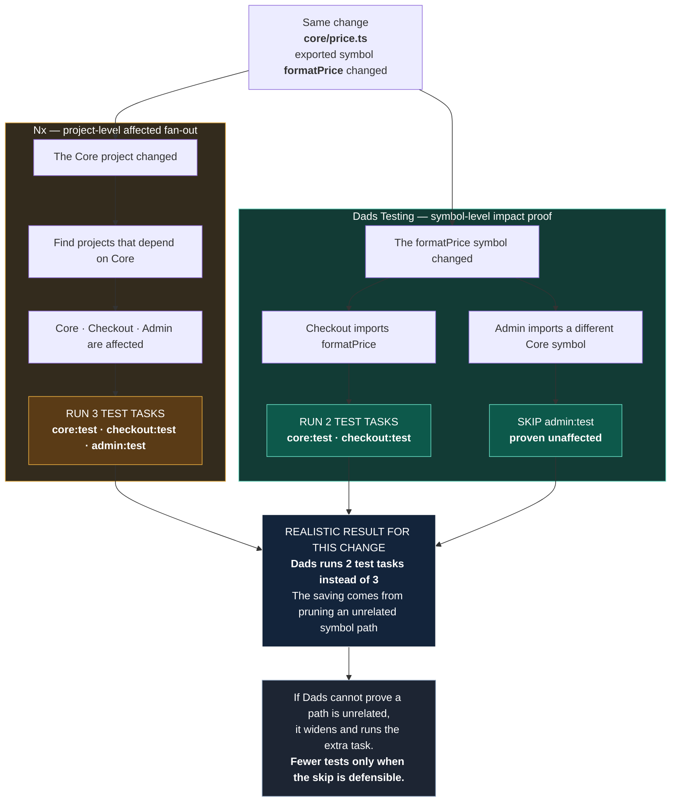

# Why Dads Testing can run less than Nx

This is the practical difference: Nx normally selects at the project/task
boundary. Dads continues through the changed symbol and can remove downstream
tasks that depend on the project but do not use the changed behavior.

The gain is not result-cache reuse; Dads v1 always executes a selected task.
It runs less by making a narrower, inspectable selection before execution:

- Nx asks which tasks are affected through the configured project/task graph.
- Dads asks which task can actually observe the changed symbol.
- If that evidence is incomplete for an owned project, Dads widens through its
  declared dependency closure. Unowned uncertainty selects the complete
  workspace fallback. Neither path silently skips work.

The exact reduction depends on the repository. The generated-workspace proof
harness measures it against an emulated Nx closure, and an adopter's
plan-only shadow job measures it for that repository before Dads replaces an
existing gate.
